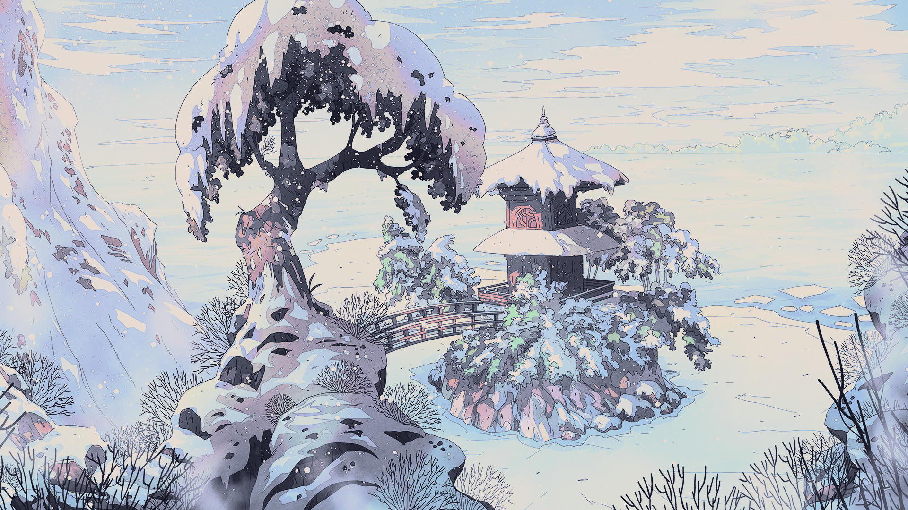
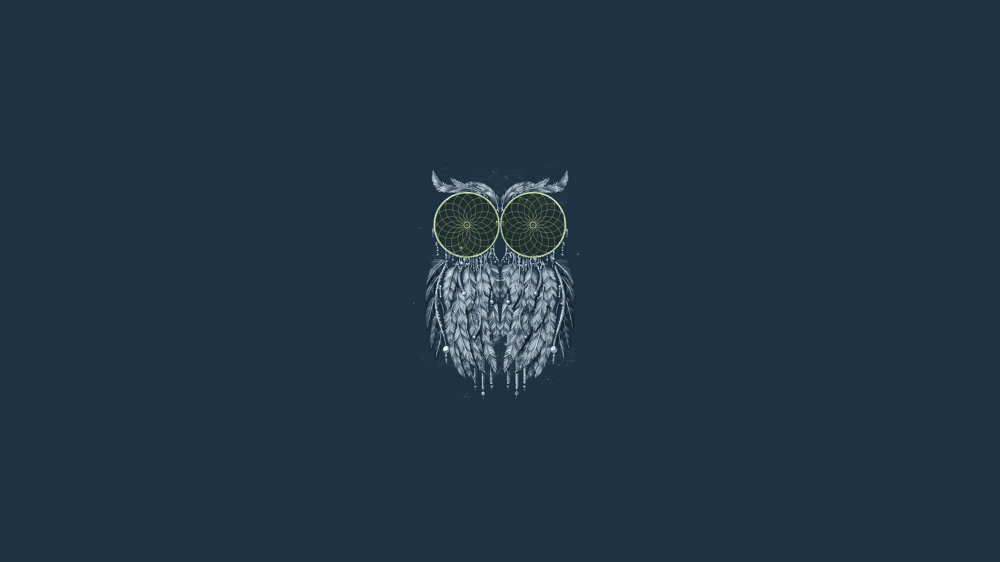

<div align="center">



<p>
  
  
  
  
</p>

**My complete Windows 11 desktop in one repo.** A tiling window manager, a blurred status bar, a slim taskbar, a JetBrains Mono system font, Catppuccin themes for every app I use, cursors, and 370+ wallpapers.

<br>

<a href="https://github.com/abdullah-al-faahim/Windows-11-Customization/archive/refs/heads/main.zip">
  
</a>

<sub>About 800 MB, mostly wallpapers. Need only part of it? See <a href="#-download-only-what-you-need">Download only what you need</a>.</sub>

</div>

<br>

## 📑 Contents

- [What's inside](#-whats-inside)
- [Repository layout](#-repository-layout)
- [Quick start](#-quick-start)
- [Download only what you need](#-download-only-what-you-need)
- [Wallpaper preview](#-wallpaper-preview)
- [Tips](#-tips)
- [Credits](#-credits)

## ✨ What's inside

### 🪟 Desktop core

| | Component | What it does | Guide |
|---|---|---|---|
| 🧱 | **GlazeWM** | Tiling window manager: 8px gaps, focus borders, vim-style `Alt` keybindings | [configs/glazewm](configs/glazewm) |
| 📊 | **YASB** | Blurred top bar with home menu, media, clock, tray, network traffic and power menu | [configs/yasb](configs/yasb) |
| 🦅 | **Windhawk** | Five mods: taskbar styler, 36px taskbar, labels, scroll-for-volume, notification center | [configs/windhawk](configs/windhawk) |
| 🚀 | **Flow Launcher** | Catppuccin Mocha theme for the app launcher | [configs/flow-launcher](configs/flow-launcher) |

### 💻 Terminal & development

| | Component | What it does | Guide |
|---|---|---|---|
| ⬛ | **Windows Terminal** | Catppuccin Mocha, acrylic at 80% opacity, JetBrainsMono Nerd Font | [configs/windows-terminal](configs/windows-terminal) |
| 🐚 | **PowerShell** | Profile based on ChrisTitusTech's, plus the Winhance one-liner | [configs/powershell](configs/powershell) |
| ⚡ | **Fastfetch** | Catppuccin-colored system info with a custom ASCII logo | [configs/fastfetch](configs/fastfetch) |
| 🧩 | **VS Code** | Settings plus the bundled Catppuccin theme `.vsix` | [configs/vscode](configs/vscode) |

### 🎨 App themes

| | Component | What it does | Guide |
|---|---|---|---|
| 🎥 | **OBS Studio** | Catppuccin Mocha `.ovt` theme | [configs/obs](configs/obs) |
| 💬 | **Discord** | Catppuccin Mocha QuickCSS import (Vencord / BetterDiscord) | [configs/discord](configs/discord) |
| 🌐 | **Browser** | Stylus backup with custom site styles and my extension list | [configs/browser](configs/browser) |

### ⚙️ System tweaks & assets

| | Component | What it does | Guide |
|---|---|---|---|
| 🔤 | **System font** | Swap Segoe UI for JetBrains Mono through the registry, with a restore file | [tweaks/system-font](tweaks/system-font) |
| 🪟 | **ExplorerBlurMica** | Acrylic / Mica blur behind File Explorer | [tweaks/explorer-blur-mica](tweaks/explorer-blur-mica) |
| 🖱️ | **Cursors** | Catppuccin Mocha and Latte in 16 accents each, plus a macOS Tahoe cursor | [cursors](cursors) |
| 🖼️ | **Wallpapers** | 370+ images: Catppuccin, macOS Tahoe, Night Owl and more | [wallpapers](wallpapers) |

Every folder has its own `README.md` with exact install paths and steps.

## 🗂 Repository layout

```text
Windows-11-Customization/
├── configs/                  App and tool configuration files
│   ├── glazewm/              config.yaml
│   ├── yasb/                 config.yaml, styles.css (old/ holds earlier versions)
│   ├── windhawk/             one JSON settings file per mod
│   ├── flow-launcher/        Catppuccin Mocha.xaml
│   ├── windows-terminal/     settings.json
│   ├── powershell/           Microsoft.PowerShell_profile.ps1, winhance.md
│   ├── fastfetch/            config.jsonc, ascii.txt
│   ├── vscode/               settings.json, catppuccin-vsc-3.18.1.vsix
│   ├── obs/                  Catppuccin_Mocha.ovt
│   ├── discord/              catppuccin-mocha.css
│   └── browser/              stylus-backup.json, extensions.txt
├── tweaks/                   System-level changes
│   ├── system-font/          JetBrains Mono zip, ChangeFont.reg, RestoreFont.reg
│   └── explorer-blur-mica/   ExplorerBlurMica.dll, config.ini, register/uninstall scripts
├── cursors/
│   ├── catppuccin-mocha/     16 accent colors
│   ├── catppuccin-latte/     16 accent colors
│   └── macos-tahoe/
├── wallpapers/
│   ├── catppuccin/   macos/   night-owl/   favourites/   classic/
└── assets/                   Images used by this README
```

## 🚀 Quick start

1. **Download** the [ZIP](https://github.com/abdullah-al-faahim/Windows-11-Customization/archive/refs/heads/main.zip) and extract it, or clone it:
   ```bash
   git clone https://github.com/abdullah-al-faahim/Windows-11-Customization.git
   ```
2. **Install the tools** you want: [GlazeWM](https://github.com/glzr-io/glazewm), [YASB](https://github.com/amnweb/yasb), [Windhawk](https://windhawk.net/), [Flow Launcher](https://www.flowlauncher.com/), [Fastfetch](https://github.com/fastfetch-cli/fastfetch). With winget:
   ```bash
   winget install glzr-io.glazewm AmN.yasb RamenSoftware.Windhawk Flow-Launcher.Flow-Launcher Fastfetch-cli.Fastfetch
   ```
3. **Install a Nerd Font.** YASB, Terminal and Fastfetch use [JetBrainsMono Nerd Font](https://www.nerdfonts.com/font-downloads) for icons.
4. **Copy the configs.** Each folder's README lists the exact destination. The common ones:

   | Config | Destination |
   |---|---|
   | GlazeWM | `%USERPROFILE%\.glzr\glazewm\config.yaml` |
   | YASB | `%USERPROFILE%\.config\yasb\` |
   | Fastfetch | `%USERPROFILE%\.config\fastfetch\` |
   | Flow Launcher theme | `%APPDATA%\FlowLauncher\Themes\` |
   | OBS theme | `%APPDATA%\obs-studio\themes\` |
   | PowerShell | the path printed by `$PROFILE` |

5. **Start on login.** Press `Win + R`, type `shell:startup`, and add shortcuts to `glazewm.exe` and `yasb.exe` (or turn on the autostart option in each app).
6. **Sign out and back in** so the font, cursor and Explorer changes take effect.

## 📦 Download only what you need

The full ZIP is large because of the wallpapers. These links download a single folder as its own ZIP, through the free [download-directory.github.io](https://download-directory.github.io/) service:

| Folder | Size | Download |
|---|---|---|
| All configs | ~1 MB | [](https://download-directory.github.io/?url=https://github.com/abdullah-al-faahim/Windows-11-Customization/tree/main/configs) |
| System tweaks | ~6 MB | [](https://download-directory.github.io/?url=https://github.com/abdullah-al-faahim/Windows-11-Customization/tree/main/tweaks) |
| Cursors | ~73 MB | [](https://download-directory.github.io/?url=https://github.com/abdullah-al-faahim/Windows-11-Customization/tree/main/cursors) |
| Wallpapers | ~800 MB | [](https://download-directory.github.io/?url=https://github.com/abdullah-al-faahim/Windows-11-Customization/tree/main/wallpapers) |
| Everything | ~880 MB | [](https://github.com/abdullah-al-faahim/Windows-11-Customization/archive/refs/heads/main.zip) |

## 🖼 Wallpaper preview

<table>
  <tr>
    <td></td>
    <td></td>
    <td></td>
  </tr>
  <tr>
    <td></td>
    <td></td>
    <td></td>
  </tr>
</table>

<p align="center"><a href="wallpapers">Browse all wallpapers →</a></p>

## 💡 Tips

- **Back up first.** Save your existing config files and create a system restore point before running any `.reg` or `.cmd` file.
- **Go one tool at a time** so it's easy to tell which change caused a problem.
- **Undo is included.** `RestoreFont.reg` brings back Segoe UI, and ExplorerBlurMica ships with `uninstall.cmd`.
- **Big Windows updates** can break taskbar mods. If the taskbar looks wrong after an update, update Windhawk and its mods.

## 🙏 Credits

This setup is built on other people's work. Please support their projects:

[GlazeWM](https://github.com/glzr-io/glazewm) ·
[YASB](https://github.com/amnweb/yasb) ·
[Windhawk](https://github.com/ramensoftware/windhawk) ·
[Flow Launcher](https://github.com/Flow-Launcher/Flow.Launcher) ·
[Catppuccin](https://github.com/catppuccin) ·
[ExplorerBlurMica](https://github.com/Maplespe/ExplorerBlurMica) ·
[JetBrains Mono](https://github.com/JetBrains/JetBrainsMono) ·
[Nerd Fonts](https://github.com/ryanoasis/nerd-fonts) ·
[Fastfetch](https://github.com/fastfetch-cli/fastfetch) ·
[ChrisTitusTech PowerShell profile](https://github.com/ChrisTitusTech/powershell-profile)

Wallpapers belong to their original artists.

## 📜 Disclaimer

Use at your own risk. Some files change the registry and system DLL registration. They worked on my machine, but no setup is guaranteed to survive every Windows update.

<p align="center">
  
  <br>
  Made with 💜 by <a href="https://github.com/abdullah-al-faahim">abdullah-al-faahim</a>
</p>
